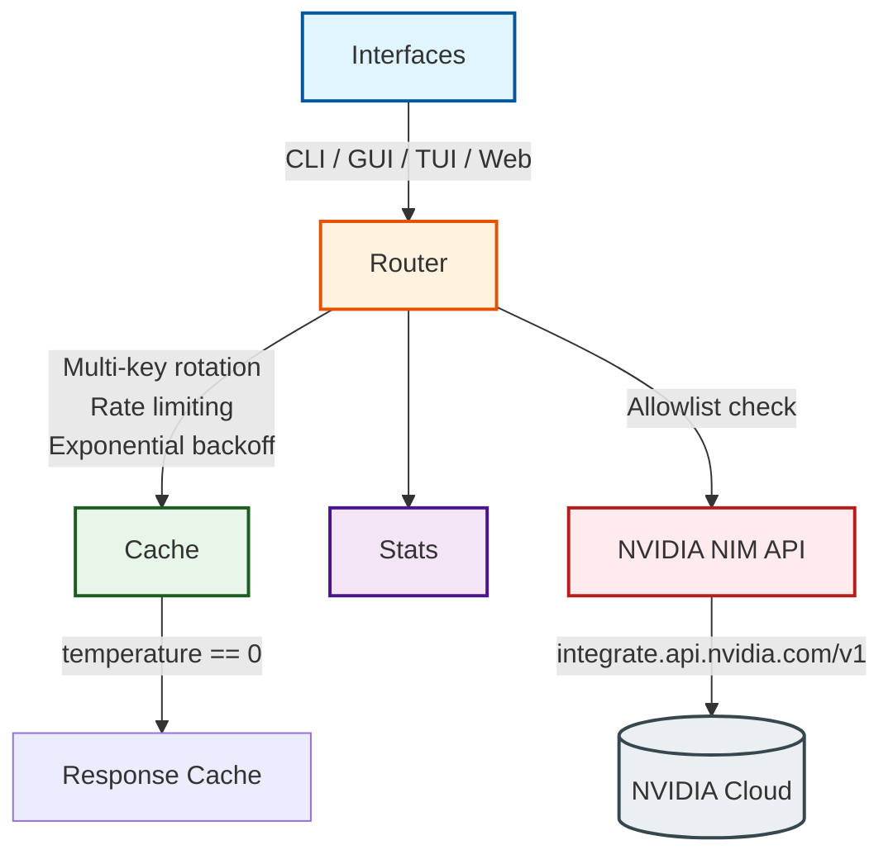

# zrouter — NVIDIA Free-Model Router

> OpenAI-compatible proxy/router สำหรับ NVIDIA hosted NIM endpoints แบบ local-first และ self-hosted

[](https://github.com/cvsz/zrouter/actions/workflows/ci-cd.yml)
[](https://www.python.org/)
[](LICENSE)
[](https://github.com/cvsz/zrouter/releases)
[](Final-Report.md)


**เวอร์ชันปัจจุบัน:** `1.0.0`  
**สถานะ:** Active development — release readiness is determined by commit-scoped CI and runtime evidence, not feature claims.

---

## Status Badges

| Check | Badge | Status |
|-------|-------|--------|
| CI / Build | [](https://github.com/cvsz/zrouter/actions/workflows/ci-cd.yml) | Live workflow status |
| License | [](LICENSE) | MIT |
| Python | [](https://www.python.org/) | 3.10+ |
| Final Report | [](Final-Report.md) | Complete |

---

## ภาพรวม (Executive Summary)

zrouter คือ **OpenAI-compatible proxy/router** ที่ออกแบบมาให้ครอบคลุมทุกระบบใน codebase เดียว:

- **CLI** — คำสั่งบรรทัดสำหรับ chat, list, probe, stats, keys, serve, models, discover, providers
- **GUI** — Tkinter-based desktop GUI (`zrouter-gui.py`)
- **TUI** — Textual-based terminal UI (`zrouter-tui.py`)
- **Web Dashboard** — Flask + Gunicorn, browser-based management console พร้อม Overview, Models, Chat, Stats
- **API Server** — RESTful API พร้อม `/health`, `/v1/models`, `/stats`, `/v1/chat/completions`, `/v1/embeddings`
- **Free-Only Allowlist** — เรียกเฉพาะโมเดลฟรีเท่านั้น ปฏิเสธโมเดลเสียค่าบริการ
- **Multi-Key Rotation** — บน HTTP 429 キーจะถูกพักและลองใหม่กับキーถัดไป
- **Per-Key Rate Limiting** — Token-bucket style rate limiter ต่อ API key
- **Exponential Backoff** — ต่อ (key, model) คู่เมื่อล้มเหลว
- **Auto Routing** — จำแนกคำถามเป็น general/code/reasoning/fast/vision routes
- **Streaming (SSE)** — พร้อม failover ก่อนไบต์แรก
- **Response Caching** — สำหรับ temperature == 0, ไม่มี tools, non-stream requests
- **Persistent Stats** — ต่อ model / ต่อ key: ok, fail, 429, latency
- **OpenAI-Compatible Proxy** — ชี้ OpenAI client ใดก็ได้มาที่ zrouter

---

## จุดเด่นหลัก

| คุณสมบัติ | รายละเอียด |
|---|---|
| **Free-Only Allowlist** | เรียกเฉพาะโมเดลที่อยู่ใน allowlist เท่านั้น ปฏิเสธโมเดลเสียค่าบริการโดยเด็ดขาด |
| **Multi-Key Rotation** | เมื่อ HTTP 429 キーจะถูกบenche (เคารพ Retry-After) และส่งโมเดลเดิมซ้ำกับキーถัดไป |
| **Per-Key Rate Limiting** | Token-bucket style rate limiter ต่อ API key |
| **Exponential Backoff** | ต่อ (key, model) คู่เมื่อล้มเหลว |
| **Auto Routing** | จำแนก prompt อัตโนมัติเป็น general/code/reasoning/fast/vision routes |
| **Streaming (SSE)** | สตรีมโทเค็นแบบเรียลไทม์ พร้อม failover ก่อนไบต์แรก |
| **Response Caching** | แคชเมื่อ temperature == 0, ไม่มี tools, non-stream requests |
| **Persistent Stats** | สถิติต่อ model / ต่อ key: ok, fail, 429, latency |
| **OpenAI-Compatible Proxy** | ชี้ OpenAI client ใดก็ได้มาที่ `http://HOST:PORT/v1` |
| **Web Dashboard** | Luxury dashboard แบบ gold/dark theme มี Overview, Models, Chat, Stats |
| **Local-First** | รันได้เต็มรูปแบบบน infrastructure ของคุณ ไม่ต้องพึ่ง cloud |

---

## Bridge Infrastructure

zrouter ไม่ต้องการฐานข้อมูลภายนอก ใช้ไฟล์ JSON (`models.json`, `provider.json`) และสถิติแบบ JSON ที่เก็บใน `~/.nvidia_free_router` หรือ `NVIDIA_ROUTER_HOME`

### การกำหนดค่าเริ่มต้น
- **ไฟล์โมเดล:** `models.json`
- **ไฟล์ผู้ให้บริการ:** `provider.json`
- **ฐานข้อมูลสถิติ:** `~/.nvidia_free_router` (หรือ `NVIDIA_ROUTER_HOME`)
- **พอร์ตเริ่มต้น:** `8000` (สำหรับ OpenAI-compatible proxy)

---

## Platform Capabilities

### 🖥️ Interfaces

| Interface | Technology | Description |
|---|---|---|
| **CLI** | argparse | `zrouter.py` และ `zrouter` entry points |
| **GUI** | Tkinter | Desktop GUI แบบ interactive (`zrouter-gui.py`) |
| **TUI** | Textual | Terminal UI แบบ interactive (`zrouter-tui.py`) |
| **Web Dashboard** | Flask + Gunicorn | Browser-based management console (gold/dark theme: Overview, Models, Chat, Stats) |
| **API Server** | Flask + OpenAI-compatible | RESTful API พร้อม `/health`, `/v1/models`, `/stats`, `/v1/chat/completions`, `/v1/embeddings` |

### 🤖 AI & Router Runtime

- **FreeRouter** — multi-key rotation แบบ bounded (rotate → bench → retry → dead key drop)
- **Auto Router** — จำแนก prompt อัตโนมัติเป็น routes
- **Token-Bucket Rate Limiter** — ต่อ API key
- **Exponential Backoff** — ต่อ (key, model) คู่
- **Streaming (SSE)** — สตรีมโทเค็นแบบเรียลไทม์ พร้อม failover
- **Response Cache** — แคชเมื่อ temperature == 0
- **Persistent Stats** — สถิติต่อ model / ต่อ key
- **Allowlist** — free-only model allowlist

### 🏗️ Architecture

Bot domain models are defined in `zrouter_bot_models.py`; local Vault/Memory persistence lives in `zrouter_bot_storage.py`; shared runtime primitives live in `zrouter_runtime.py`. `zrouter.py` and `zrouter_bot.py` re-export established names to preserve existing imports. See [`ARCHITECTURE.md`](ARCHITECTURE.md) for module boundaries.

<p align="center">
  
</p>



**Bridge Infrastructure** — zrouter routes traffic between local interfaces and the NVIDIA NIM API:

| Layer | Component | Responsibility |
|-------|-----------|----------------|
| **Interface Layer** | CLI / GUI / TUI / Web Dashboard | User-facing entry points |
| **Router Layer** | `FreeRouter` | Multi-key rotation, rate limiting, backoff, cache, stats |
| **Cache Layer** | `TTLCache` | Response caching (temperature == 0, no tools, non-stream) |
| **Stats Layer** | `Stats` | Persistent per-model / per-key statistics |
| **Transport Layer** | `requests` + `urllib3` | HTTP(S) to NVIDIA NIM API |
| **Upstream Layer** | NVIDIA NIM API | Free model inference endpoints |

See [`ARCHITECTURE.md`](ARCHITECTURE.md) สำหรับรายละเอียดเต็ม (ถ้ามี)

---

## 🏢 Enterprise Features

| Domain | Components |
|---|---|
| **Free-Only Allowlist** | โมเดลที่อยู่ใน allowlist เท่านั้นที่ถูกเรียก ปฏิเสธโมเดลเสียค่าบริการ |
| **Multi-Key Rotation** | หลาย API KEY, bench เมื่อ 429, dead key drop เมื่อ 401/403 |
| **Rate Limiting** | Token-bucket style ต่อ API key |
| **Backoff** | Exponential backoff ต่อ (key, model) คู่ |
| **Caching** | Response cache (temperature == 0, ไม่มี tools, non-stream) |
| **Stats** | Persistent stats ต่อ model / ต่อ key |
| **Proxy** | OpenAI-compatible proxy server |
| **Observability** | `/health`, `/stats`, structured JSON logs |

---

## 🔒 Security Boundaries

| ID | Surface | Status |
|---|---|---|
| SEC-001 | API key masking | ✅ FIXED |
| SEC-002 | Paid model rejection | ✅ FIXED |
| SEC-003 | Rate limit enforcement | ✅ FIXED |
| SEC-004 | Dead key drop (401/403) | ✅ FIXED |
| SEC-005 | Input validation | ✅ FIXED |
| SEC-006 | Proxy token auth (ROUTER_TOKEN) | Implemented |
| SEC-007 | Bot vault at rest | Native OS keyring; plaintext fallback disabled; legacy JSON requires explicit migration |

See [`SECURITY.md`](SECURITY.md) สำหรับรายละเอียด

---

## เริ่มต้นใช้งาน

### Requirements

- Python 3.10+
- pip
- (อย่างน้อย 1) NVIDIA API key (ดูที่ https://build.nvidia.com)

```bash
git clone https://github.com/cvsz/zrouter.git
cd zrouter

python -m venv .venv
source .venv/bin/activate        # Windows: .venv\Scripts\activate
python -m pip install --upgrade pip
pip install -e .
```

Development dependencies:

```bash
pip install -e '.[dev]'
```

Core runtime dependencies include `requests` and `keyring`; optional groups: `dev` (pytest, ruff, pyinstaller) and `web` (flask, gunicorn)

### Verification

```bash
zrouter --version
zrouter --help
python zrouter.py --help
python zrouter.py list
```

### การใช้งานพื้นฐาน

```bash
# ตั้งค่า API key(s)
export NVIDIA_API_KEYS="nvapi-xxx,nvapi-yyy"

# รายการโมเดลที่อนุญาต
python zrouter.py list

# แชทแบบ auto-route
python zrouter.py chat "write a regex for emails"

# แชทแบบระบุ route
python zrouter.py chat "explain TCP slow start" --route reasoning --stream

# รัน OpenAI-compatible proxy
python zrouter.py serve --port 8000 --token secret
```

### Web Dashboard

```bash
# Build และรันในคำสั่งเดียว
export NVIDIA_API_KEYS="nvapi-xxx,nvapi-yyy"
make build:deploy

# หรือ แยกเป็นขั้นตอน
make build:web        # สร้าง web package
make build:web:start  # เริ่ม server ที่ http://localhost:8000
```

---

## No-Cost-First Execution Model

zrouter แยก **cost classification** จาก **runtime availability**:

```text
Cost Classes:
  FREE_ONLY     → โมเดลใน allowlist เท่านั้น (free models)
  PAID_BLOCKED  → โมเดลเสียค่าบริการถูกปฏิเสธโดยเด็ดขาด

Policy Mode:
  FREE_ONLY     → เรียกเฉพาะโมเดลฟรี ไม่ silent fallback ไป paid transport
```

**กฎสำคัญ:** Free-only routing **ต้องไม่ silent fallback** ไป paid transport

---

## CLI Commands

```bash
# Core
zrouter keys                        # แสดงสถานะ API key แต่ละอัน (masked)
zrouter list                        # รายการโมเดลที่อนุญาต grouped by route
zrouter models                      # รายการโมเดลใน catalog พร้อม free/paid/provider
zrouter models --free               # เฉพาะโมเดลฟรี
zrouter models --paid               # เฉพาะโมเดลเสียค่าบริการ
zrouter providers                   # รายการผู้ให้บริการพร้อมจำนวน key และ base URL
zrouter discover                    # ค้นหาโมเดลจาก NVIDIA API (pricing ใหม่จะเป็น unverified)
zrouter probe                       # ส่ง request ทดสอบทุกโมเดลที่อนุญาต
zrouter stats                       # สถิติต่อ model และต่อ key

# Chat
zrouter chat "prompt"               # แชทแบบ auto-route
zrouter chat "prompt" --route code  # ระบุ route
zrouter chat "prompt" --stream      # สตรีมตอบกลับ
zrouter chat "prompt" --model glm-4.7  # ระบุโมเดลเฉพาะ

# Proxy Server
zrouter serve --port 8000 --token secret   # OpenAI-compatible proxy

# Help
zrouter help                        # ความช่วยเหลือทั้งหมด
zrouter help quickstart             # เริ่มต้นใช้งาน
zrouter help serve                  # การตั้งค่า proxy
```

---

## Configuration

### Environment Variables

| Variable | Description | Required |
|---|---|---|
| `NVIDIA_API_KEYS` | NVIDIA API key(s), comma/space/newline separated | Yes |
| `NVIDIA_API_KEY` | Single NVIDIA API key (alternative) | Optional |
| `NVIDIA_BASE_URL` | NVIDIA NIM API base URL | Optional (default: `https://integrate.api.nvidia.com/v1`) |
| `NVIDIA_RPM` | Per-key requests per minute | Optional (default: 35) |
| `NVIDIA_CACHE_TTL` | Cache TTL in seconds (0 = off) | Optional (default: 3600) |
| `NVIDIA_TIMEOUT` | Request timeout in seconds | Optional (default: 90) |
| `NVIDIA_MAX_WAIT` | Max seconds to wait when all keys limited | Optional (default: 60) |
| `NVIDIA_ROUTER_CONFIG` | Path to router.json config | Optional |
| `NVIDIA_ROUTER_HOME` | Stats directory | Optional (default: `~/.nvidia_free_router`) |
| `ROUTER_TOKEN` | Bearer token required by the proxy | Optional |
| `WEB_HOST` | Web server bind host | Optional (default: `0.0.0.0`) |
| `WEB_PORT` | Web server bind port | Optional (default: 8000) |
| `WEB_DEBUG` | Flask debug mode | Optional (default: 0) |
| `WEB_WORKERS` | Gunicorn workers | Optional (default: 4) |
| `WEB_THREADS` | Gunicorn threads per worker | Optional (default: 8) |
| `WEB_LOG_LEVEL` | Log level | Optional (default: info) |

### Routes

| Route | Description |
|-------|-------------|
| `auto` | จำแนก prompt อัตโนมัติ (default) |
| `general` | คำถามทั่วไป |
| `code` | Code / debugging / regex / SQL / git |
| `reasoning` | คณิตศาสตร์, ตรรกะ, วิเคราะห์ทีละขั้น, prompt ยาว |
| `fast` | prompt สั้น, โมเดลขนาดเล็ก |
| `vision` | ข้อความที่มีรูปภาพ |

---

## Security Principles

1. **No provider secrets in client-side code**
2. **Free-only allowlist — paid models are refused by default**
3. **API keys are always masked in output**
4. **Dead keys (401/403) are dropped automatically**
5. **Rate-limited keys (429) are benched and retried on next key**
6. **Proxy authentication via `ROUTER_TOKEN` when binding to `0.0.0.0`**
7. **Audit/evidence visible — no mocks presented as real-runtime proof**

See [`SECURITY.md`](SECURITY.md) สำหรับรายละเอียด

---

## Development

### Prerequisites

```bash
python -m venv .venv
source .venv/bin/activate
pip install -e '.[dev]'
```

### Quality Checks

```bash
# Lint & format
ruff check zrouter.py test_zrouter.py zrouter-gui.py zrouter-tui.py
ruff format --check zrouter.py test_zrouter.py zrouter-gui.py zrouter-tui.py

# Tests
pytest test_zrouter.py -v

# Minimum coverage: 100%
```

### CI Matrix

| Python Version | Status |
|---|---|
| 3.10 | ✅ Supported (minimum) |
| 3.11 | ✅ Supported |
| 3.12 | ✅ Supported |
| 3.13 | ✅ Supported |
| 3.14 | ✅ Supported |

### Additional CI Checks

- ruff lint + format check
- pytest (60 tests, 100% pass)
- PyInstaller builds (exe, gui, prod, ent)
- Web build (Flask + Gunicorn)
- Docker build

---

## Docker

### Build and run the application image directly

```bash
docker build -t zrouter:local .
docker run --rm zrouter:local --version

# Run the proxy server
docker run --rm -d \
  --name zrouter \
  -p 8000:8000 \
  -e NVIDIA_API_KEYS="nvapi-xxx,nvapi-yyy" \
  -e ROUTER_TOKEN=changeme \
  zrouter:local
```

### Web Dashboard Docker

```bash
cd dist/web
docker build -f Dockerfile.web -t zrouter-web:latest .

docker run -d \
  --name zrouter-web \
  -p 8000:8000 \
  -e NVIDIA_API_KEYS="nvapi-xxx,nvapi-yyy" \
  -e ROUTER_TOKEN=changeme \
  zrouter-web:latest
```

The image installs the runtime dependency set from `requirements.txt`; Dependabot proposes digest updates.

---

## Operations

### Health Endpoints

```bash
GET /health       # Health + key status
GET /v1/models    # OpenAI model list
GET /stats        # Per-model / per-key statistics
POST /v1/chat/completions  # OpenAI-compatible chat
POST /v1/embeddings         # Embeddings
```

### Make Targets

| Target | Description |
|---|---|
| `make setup` | Create venv + install dependencies |
| `make install` | Install/upgrade dependencies |
| `make test` | Run pytest suite |
| `make lint` | ruff check + format check |
| `make format` | ruff format |
| `make clean` | Remove venv, build/, dist/, caches |
| `make all` | setup + lint + test |
| `make build` | Default build (setup + lint + test + exe) |
| `make build:all` | Build all variants |
| `make build:web` | Build web deployment package |
| `make build:web:all` | Build all web variants (dev + prod + ent) |
| `make build:web:start` | Start web server from dist/web/ |
| `make build:deploy` | Build web package + start server |
| `make build:exe` | Build native CLI executable |
| `make build:gui` | Build GUI executable |
| `make docker:build` | Build Docker image |
| `make docker:run` | Run Docker container |

### Deployment

```python
# Example: Deploy with Gunicorn
gunicorn -c gunicorn.conf.py web_app:app
```

### systemd Service (Linux)

Create `/etc/systemd/system/zrouter.service`:

```ini
[Unit]
Description=NVIDIA Free-Model Router
After=network.target

[Service]
Type=simple
User=zrouter
WorkingDirectory=/opt/zrouter/dist/web
Environment=NVIDIA_API_KEYS=nvapi-xxx,nvapi-yyy
Environment=NVIDIA_BASE_URL=https://integrate.api.nvidia.com/v1
Environment=NVIDIA_RPM=35
ExecStart=/opt/zrouter/.venv/bin/python -m gunicorn -c gunicorn.conf.py web_app:app
Restart=always
RestartSec=5

[Install]
WantedBy=multi-user.target
```

```bash
sudo systemctl daemon-reload
sudo systemctl enable zrouter
sudo systemctl start zrouter
```

---

## Observability

### Endpoints

| Endpoint | Method | Auth | Description |
|---|---|---|---|
| `/health` | GET | Token* | Health + key status |
| `/v1/models` | GET | Token* | OpenAI model list |
| `/stats` | GET | Token* | Per-model / per-key statistics |
| `/list` | GET | Token* | Allowlisted models grouped by route |
| `/v1/chat/completions` | POST | Token* | OpenAI-compatible chat |
| `/v1/embeddings` | POST | Token* | Embeddings |

\* Required when `ROUTER_TOKEN` is set.

**Request limits:** Max body size 16 MiB (`MAX_CONTENT_LENGTH`), matching `zrouter.py` `_read_body` cap. Requests exceeding this return HTTP 413.

### Logging

- **Format:** JSON (non-TTY) หรือ text (interactive TTY)
- **Redaction:** API keys filtered อัตโนมัติ
- **Destination:** stderr only

---

## Documentation

| Document | Description |
|---|---|
| [`README.md`](README.md) | This document |
| [`DEPLOYMENT.md`](DEPLOYMENT.md) | Deployment guide |
| [`README.web.md`](README.web.md) | Web dashboard documentation |
| [`CHANGELOG.md`](CHANGELOG.md) | Release history |
| [`SECURITY.md`](SECURITY.md) | Security guidance |
| [`CONTRIBUTING.md`](CONTRIBUTING.md) | Contribution workflow |
| [`VALIDATION_RESULTS.md`](VALIDATION_RESULTS.md) | Validation results |
| [`DEPLOYMENT.md`](DEPLOYMENT.md) | Deployment runbooks |

---

## Evidence Tiers

| Tier | Description |
|---|---|
| **1. Source** | Implemented in `zrouter.py` |
| **2. Unit** | Contract/unit tests (60 tests) |
| **3. Integration** | Controlled dependency testing |
| **4. Live Runtime** | Verified against real local/external runtime |
| **5. Production** | Verified in target deployment environment |

> **Important:** A model catalog entry is NOT proof of installed/runnable model. An adapter contract test is NOT proof of real inference. Evidence must match the claim tier.

---

## NVIDIA Credit & Attribution

zrouter is an independent OpenAI-compatible proxy/router that connects to **NVIDIA hosted NIM endpoints** (`https://integrate.api.nvidia.com/v1`) to route requests to free models.

### NVIDIA Trademarks & Branding

- **NVIDIA**, the **NVIDIA logo**, and **NVIDIA NIM** are trademarks or registered trademarks of NVIDIA Corporation in the United States and other countries.
- The NVIDIA logo image (`static/img/nvidia.png`) is used for attribution purposes only and remains the property of NVIDIA Corporation.
- zrouter is **not affiliated with, endorsed by, or sponsored by NVIDIA Corporation**.

### API Usage

zrouter calls NVIDIA's hosted NIM API using API keys you provide. Please review NVIDIA's terms of service and model-specific licensing at https://build.nvidia.com before using any model, especially regarding commercial use, data handling, and rate limits.

---

## License

zrouter is released under the [MIT License](LICENSE).

---

## Project Status

**Actively maintained.** The repository contains mature integration surfaces and active development on web dashboard and deployment subsystems. When evaluating production readiness, use CI results, release gates, real-runtime evidence, and documented subsystem limitations — not feature names alone.

**Current Baseline:** `main`  
**Security:** API key masking, paid model rejection, rate limiting, dead key drop verified.

---

## Contributing

Contributions must preserve:

- ✅ No mandatory commercial dependency for no-cost core
- ✅ No silent downgrade of security, free-only allowlist, or approval semantics
- ✅ No provider secrets in client-side code
- ✅ No fake/simulated evidence presented as real-runtime proof
- ✅ Deterministic tests for routing, policy, and failure paths
- ✅ Backward compatibility where practical

Before opening a PR:

```bash
ruff check zrouter.py test_zrouter.py zrouter-gui.py zrouter-tui.py
ruff format --check zrouter.py test_zrouter.py zrouter-gui.py zrouter-tui.py
pytest test_zrouter.py -v
```

See [`CONTRIBUTING.md`](CONTRIBUTING.md) for the full workflow.

---